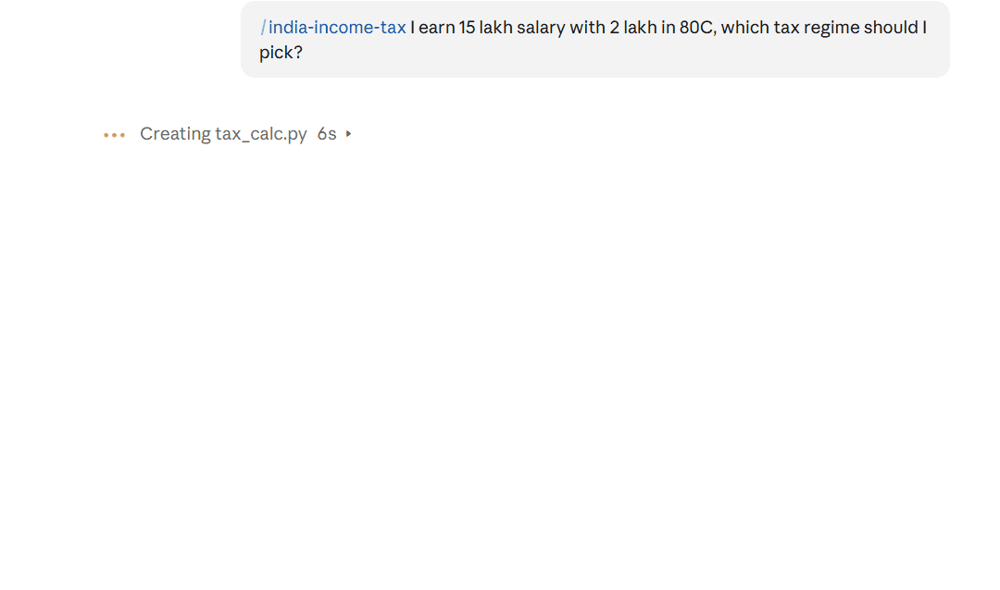

# country-skills 🌍

[](https://github.com/ronitgupta43-ops/country-skills/actions/workflows/check.yml)

AI skills for money, jobs, crypto and content creators, country by country. Most finance and career skills assume you live in the US. These follow each country's real tax rules and hiring norms, and every number comes from a tested calculator, not the AI's guess.



Works with Claude, Codex, Gemini CLI, Cursor, GitHub Copilot and other tools that read the open [Agent Skills](https://agentskills.io) format.

## Skill tree

<!-- tree:start -->
```
country-skills
├── 🇨🇦 Canada
│   ├── canada-finance
│   │   ├── canada-capital-gains        Adjusted cost base (average cost), realized capital gains/losses per…
│   │   ├── canada-creator-tax          Tax for Canadian content creators and influencers: what the CRA counts…
│   │   ├── canada-crypto-tax           Canadian crypto tax: adjusted cost base (average cost) pooled across…
│   │   └── canada-registered-accounts  Work out TFSA, RRSP and FHSA contribution room and which account to…
│   └── canada-jobs
│       ├── canada-cover-letter    Write a short, tailored Canadian cover letter from the user's resume…
│       ├── canada-interview-prep  Prepare for a Canadian job interview with likely questions, STAR…
│       └── canada-resume          Rewrite or review a resume in Canadian format and tailor it to a job…
├── 🇮🇳 India
│   ├── india-finance
│   │   ├── india-capital-gains  STCG and LTCG on Indian listed shares and equity mutual funds using…
│   │   ├── india-creator-tax    Tax for Indian YouTubers, Instagram influencers and content creators…
│   │   ├── india-crypto-tax     Indian crypto (VDA) tax: flat 30% on gains, no loss set-off, 1% TDS on…
│   │   ├── india-gst            Indian GST for small businesses and freelancers: GST 2.0 rates, whether…
│   │   ├── india-income-tax     Calculate Indian income tax and compare the new and old regimes for Tax…
│   │   └── india-nri-return     Checklist for NRIs moving back to India: residential status (RNOR)…
│   └── india-jobs
│       ├── india-interview-prep  Prepare for an Indian job interview (HR, technical/functional and…
│       └── india-resume          Write or improve a resume for the Indian job market and…
├── 🇺🇸 United States
│   ├── us-finance
│   │   ├── us-creator-tax          Tax for US content creators and influencers: 1099-NEC/1099-K thresholds…
│   │   ├── us-crypto-tax           US crypto tax: per-wallet FIFO cost basis, short vs long term gains…
│   │   ├── us-income-tax           Estimate US federal income tax for 2026 including long-term capital…
│   │   └── us-retirement-accounts  2026 limits and rules for 401(k), traditional IRA, Roth IRA and HSA…
│   └── us-jobs
│       ├── us-interview-prep  Prepare for a US job interview: behavioral STAR answers, likely…
│       └── us-resume          Write or review a US resume and cover letter tailored to a job posting…
└── 🌍 Any country
    ├── creator
    │   ├── creator-brand-deals     Help creators land and run brand deals: media kit, rate card from their…
    │   ├── creator-content-plan    Plan content for a creator: content pillars, a weekly/monthly calendar…
    │   └── creator-content-writer  Write hooks, captions, Reel/Shorts/TikTok scripts, carousel text and…
    └── crypto
        └── crypto-portfolio  Combine crypto exports from Binance, Coinbase, Kraken, Wealthsimple…
```

25 skills in 8 plugins. Install a whole plugin or any single skill.
<!-- tree:end -->

## Install

Claude Code (install only what you need):
```
/plugin marketplace add ronitgupta43-ops/country-skills
/plugin install india-finance@country-skills      # any plugin name from the tree
```

Codex, Gemini CLI, Cursor, Copilot and 30+ other agents:
```
npx skills add ronitgupta43-ops/country-skills
npx skills add ronitgupta43-ops/country-skills --skill india-income-tax   # just one skill
```

claude.ai: zip a skill folder (e.g. `plugins/india-finance/skills/india-income-tax`) and upload it under Customize → Skills.

ChatGPT, Gemini app or any chat AI: paste the text of a `SKILL.md` into the chat (or a custom GPT / Gem), then ask your question. Calculator code is included at the end of each SKILL.md, so it works even without the scripts folder.

## Try the calculators

```
python plugins/india-finance/skills/india-income-tax/scripts/tax_calc.py --income 1500000 --salaried
python plugins/canada-finance/skills/canada-registered-accounts/scripts/tfsa_room.py --start 2022
python plugins/us-finance/skills/us-income-tax/scripts/us_tax.py --wages 85000 --ltcg 4000
python plugins/crypto/skills/crypto-portfolio/scripts/crypto.py examples/crypto-ledger.csv ca
```

More examples in [examples/](examples). Python 3.9+, no dependencies.

## How it stays accurate

- Every calculator has a built-in self-check, and CI runs all of them on every change.
- `tools/build.py` regenerates this tree and the code copies inside each SKILL.md; CI fails if anything is out of date.
- Each January an issue opens automatically to update tax limits for the new year.

## Contributing

Know your country's tax rules or job market? Add it. See [CONTRIBUTING.md](CONTRIBUTING.md). Open issues for the UK, Australia and UAE are waiting.

Not financial, tax or legal advice.

MIT License
